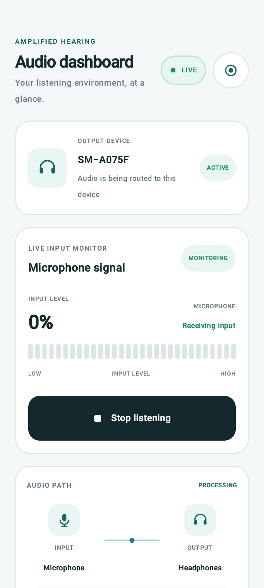
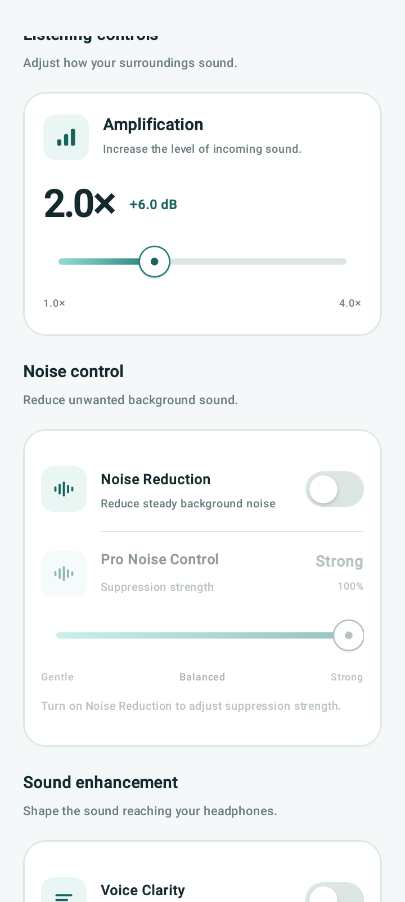
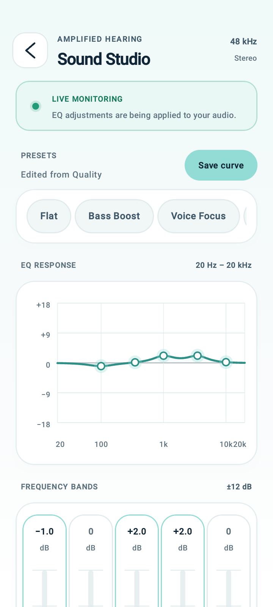
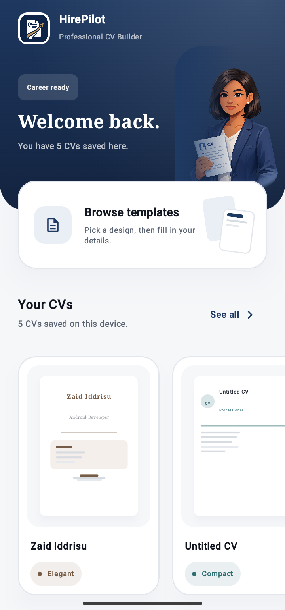
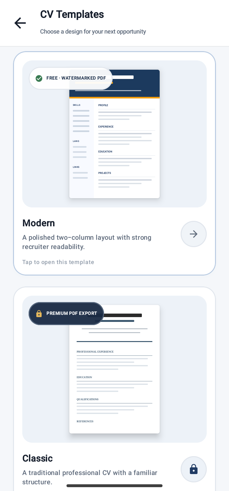
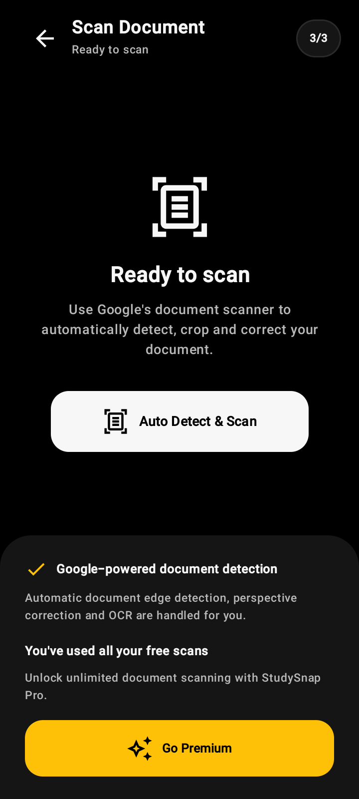
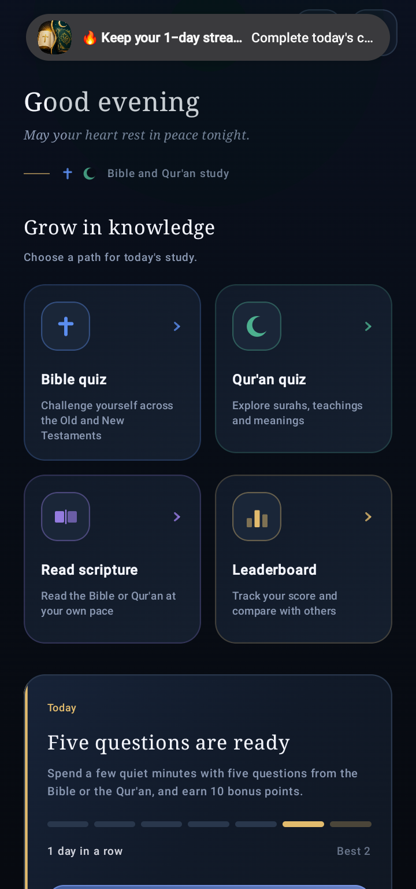

# ZID TECH | Android Development Portfolio

**Android Developer · Kotlin · Jetpack Compose · Firebase**

I'm an independent Android developer based in Ghana. I build, improve, and maintain native Android applications using modern Android technologies.

This portfolio showcases four Android applications I've developed and published on Google Play.

---

## Featured Projects

### 1. Amplified Hearing

**Category:** Audio  
**Technologies:** Kotlin, Jetpack Compose, Android Audio APIs, Google Play Billing

An Android application that amplifies microphone audio and routes processed sound to connected headphones.

**Screenshots**

  
  
  

**Key Features**
- Real-time microphone audio amplification.
- Bluetooth and wired headphone routing.
- Adjustable amplification controls.
- Noise reduction and voice clarity controls.
- Five-band equalizer and audio balance.
- Processed audio recording for Premium users.

**Engineering Focus:** Android audio input/output, audio processing, device routing, and premium feature access.

[View on Google Play](https://play.google.com/store/apps/details?id=com.mobivision.amplifiedhearing)

---

### 2. HirePilot — CV Builder

**Category:** Productivity  
**Technologies:** Kotlin, Jetpack Compose, Android PDF APIs, Google Play Billing

A CV-building application that helps users create professional resumes using predefined templates.

**Screenshots**

  
  

**Key Features**
- CV creation and editing.
- Multiple resume templates.
- Offline saving.
- PDF generation and export.
- Premium template access.
- Premium watermark removal.

**Engineering Focus:** Document workflows, local data management, PDF generation, and purchase entitlements.

[View on Google Play](https://play.google.com/store/apps/details?id=com.zidtech.hirepilot)

---

### 3. StudySnap — Document Scanner

**Category:** Productivity  
**Technologies:** Kotlin, Jetpack Compose, Google ML Kit Document Scanner

A document-scanning application designed to help users capture and manage documents digitally.

**Screenshot**

  

**Key Features**
- Document scanning with Google ML Kit Document Scanner.
- Document capture and processing.
- PDF workflow.
- Free and Premium usage limits.

**Engineering Focus:** Integrating Google's document-scanning capabilities and implementing premium access controls.

[View on Google Play](https://play.google.com/store/apps/details?id=com.zaididdrisu.studysnap)

---

### 4. Bible & Quran Mastery

**Category:** Education  
**Technologies:** Kotlin, Jetpack Compose, Firebase Authentication, Cloud Firestore, Realtime Database, Firebase Cloud Messaging

A learning application that brings Bible and Quran study features together in one Android experience.

**Screenshot**

  

**Key Features**
- Bible and Quran reading.
- Search and bookmarks.
- Interactive quizzes.
- Daily challenges.
- Leaderboard.
- Firebase-backed application features.
- Daily content and notifications.

**Engineering Focus:** Firebase integration, user-related data management, learning workflows, and engagement features.

[View on Google Play](https://play.google.com/store/apps/details?id=com.zaididdrisu.quizapp)

---

## Technical Skills

| Area | Technologies |
|---|---|
| Programming | Kotlin |
| Android UI | Jetpack Compose, Material Design |
| Backend | Firebase Authentication, Firestore, Realtime Database |
| Notifications | Firebase Cloud Messaging |
| Audio | Android Audio APIs |
| Document Processing | ML Kit Document Scanner, PDF generation |
| Monetization | Google Play Billing |
| Development Tools | Android Studio, Git, GitHub |

---

## Android Development Services

I can help with:

- Native Android application development.
- Kotlin and Jetpack Compose UI development.
- Firebase integration and authentication.
- Google Play Billing implementation.
- New feature development and integration.
- Bug fixing and application maintenance.
- Document scanning and PDF workflows.
- Android audio functionality.

---

## Let's Work Together

I'm open to freelance projects, collaboration, and remote Android development opportunities.

**Developer:** ZID TECH  
**Email:** [zaididdrisu193@gmail.com](mailto:zaididdrisu193@gmail.com)  
**GitHub:** [github.com/zaididdrisu193-lgtm](https://github.com/zaididdrisu193-lgtm)

**Published Applications:** [View my Google Play applications](https://play.google.com/store/apps/developer?id=ZID+TECH)

---

*Selected Android applications designed, developed, and published by ZID TECH.*
